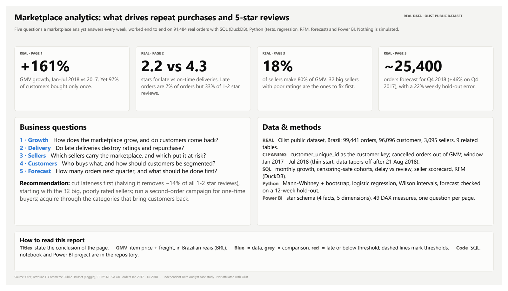
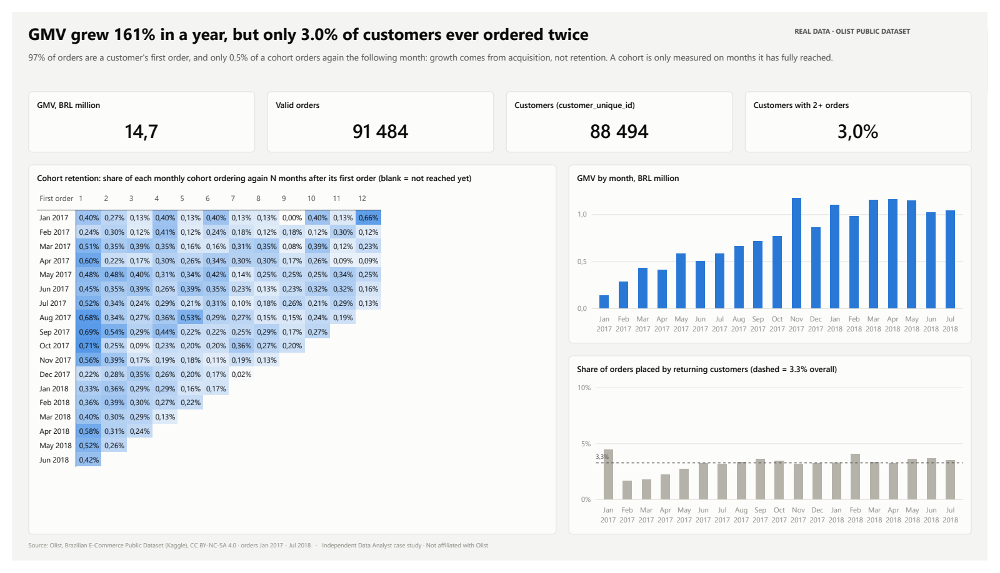
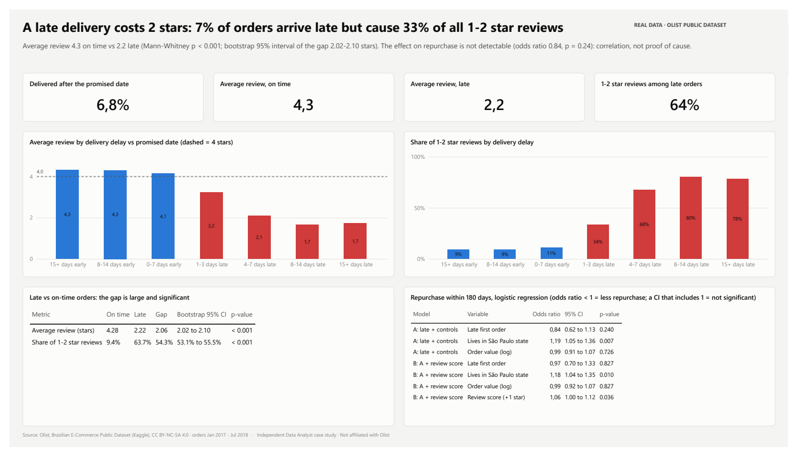
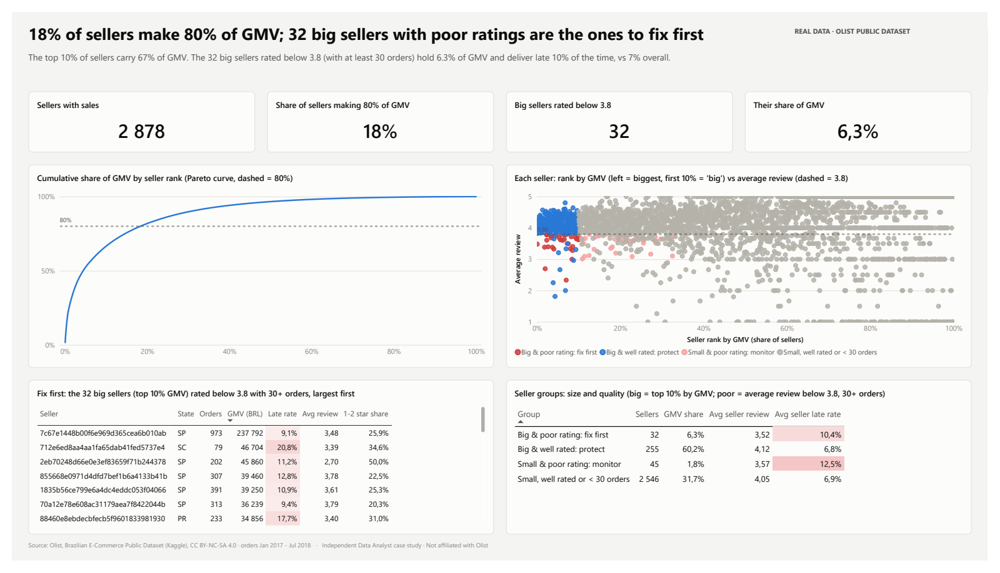
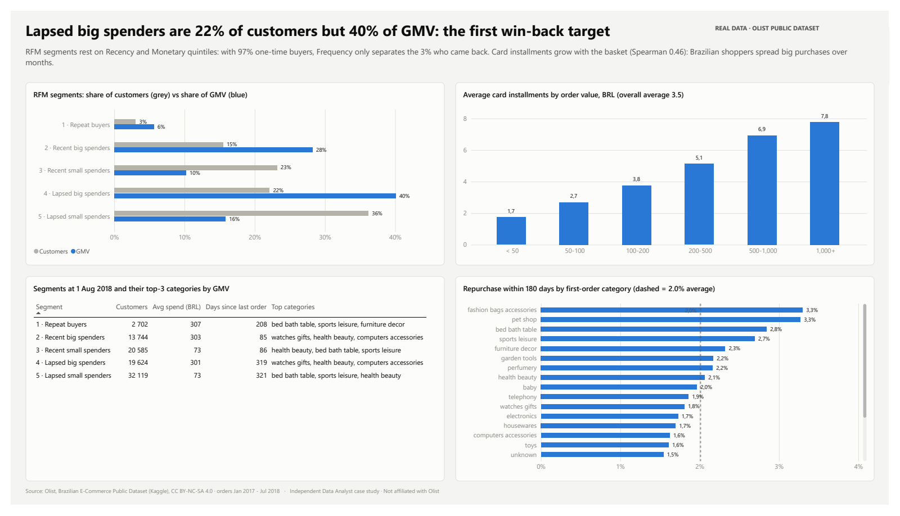
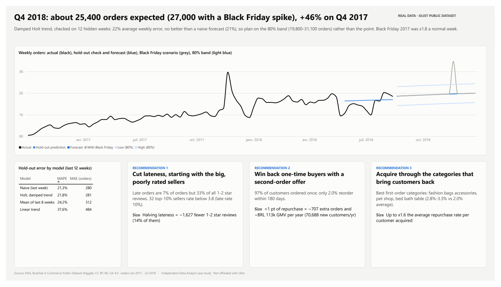

# Marketplace analytics: what drives repeat purchases and 5-star reviews

Independent case study on **real, messy, multi-table e-commerce data**: the public Olist dataset
(Brazilian marketplace, ~100k orders, 9 related tables). Nothing is simulated.
Not affiliated with Olist. Data: Olist, CC BY-NC-SA 4.0 (see [data/SOURCES.md](data/SOURCES.md)).

## Questions and answers
Analysis window: valid orders placed Jan 2017 - Jul 2018 (91,484 orders, 88,494 customers, BRL 14.7 m GMV).

| # | Question | Answer |
|---|---|---|
| 1 | How does the marketplace grow, and do customers come back? | GMV grew **+161%** (Jan-Jul 2018 vs 2017), but only **3.0%** of customers ever ordered twice and **0.5%** of a cohort orders again the next month. Growth is bought through acquisition, not retention. |
| 2 | Do late deliveries destroy ratings and repurchase? | Ratings, yes: **4.3 stars on time vs 2.2 late** (Mann-Whitney p < 0.001, bootstrap 95% CI of the gap 2.02-2.10). Late orders are **7%** of orders but **33%** of all 1-2 star reviews. Repurchase: the effect is **not detectable** (odds ratio 0.84, 95% CI 0.62-1.13), because only 2% of customers come back. |
| 3 | Which sellers carry the marketplace, and which put it at risk? | **18%** of sellers make 80% of GMV; the top 10% make 67%. **32 big sellers** rate below 3.8 (6.3% of GMV, late 10% of the time vs 7%): fix them first. |
| 4 | Who buys what, and how should customers be segmented? | RFM on Recency × Monetary (Frequency is useless when 97% buy once). **Lapsed big spenders**: 22% of customers, 40% of GMV. Card installments rise with basket size (Spearman 0.46), from 1.7 below BRL 50 to 7.8 above BRL 1,000. |
| 5 | How many orders next quarter, and what first? | **~25,400 orders in Q4 2018** (~27,000 with a Black Friday spike), +46% on Q4 2017; 80% band 19,750-31,130. The damped-trend model's hold-out error (22%) is no better than a naive forecast, so plan on the band. |

**Recommendations (sized in the notebook):**
1. **Cut lateness, starting with the 32 big, poorly rated sellers.** Halving late deliveries would remove ~1,600 1-2 star reviews (14% of them).
2. **Win back one-time buyers** with a second-order offer: each +1 pt of 180-day repurchase is worth ~700 orders and ~BRL 113k GMV a year.
3. **Acquire through the categories that bring customers back** (bed & bath, sports & leisure, pet shop, fashion bags: 2.7-3.3% repurchase vs 2.0% on average).

## The report
Six pages, one question each, title = conclusion. Full report: [docs/MarketplaceCaseStudy.pdf](docs/MarketplaceCaseStudy.pdf).



| | |
|---|---|
|  |  |
|  |  |
|  | |

## How it is built
```
data/raw/        Olist CSVs from Kaggle (not committed, see data/SOURCES.md)
data/clean/      cleaned tables (Parquet): orders, order_items, payments, reviews, customers, sellers, products
data/output/     every number shown in the report (SQL results, test statistics, forecast, kpis.csv)
sql/             DuckDB: 01 monthly growth, 02 cohort retention, 03 delivery vs review, 04 seller scorecard, 05 RFM
notebooks/       analysis.ipynb: Mann-Whitney + bootstrap, logistic regression, RFM summary, forecast with hold-out
src/             prepare_data.py, run_sql.py, build_semantic_model.py (TMDL), build_report_pages.py (PBIR)
powerbi/         Power BI project (.pbip: semantic model in TMDL + report in PBIR), .pbix, theme
docs/            report PDF and one screenshot per page
```
**Rigour points**
- `customer_id` changes with every order; the real customer is `customer_unique_id` (99,441 ids for 96,096 people).
- GMV = item price + freight from `order_items`, valid orders only (cancelled / unavailable excluded). Payments only cross-check it (0.02% gap).
- The data is thin before 2017 and fades out after 21 Aug 2018 (end of collection, not a real drop): the window is cut accordingly.
- Cohort retention is censoring-safe: a cohort only gets a value for month N once month N is over.
- Repurchase is measured over a fixed 180-day window, on first orders placed early enough for everyone to have 180 days of follow-up.
- Statistical tests match the data: review scores are ordinal 1-5 values, so Mann-Whitney + bootstrap rather than a t-test.
- The logistic regression shows a correlation, not a cause, and its non-significant result is reported as such.
- The forecast is judged on 12 weeks the model never saw, against naive baselines; known one-off shocks (Black Friday 2017, the May 2018 truckers' strike) are smoothed for fitting only.
- Every number in the report titles is read from `data/output/kpis.csv` by `build_report_pages.py`, so text and data cannot drift apart.

**Power BI model (star schema):** facts `Orders` (order grain), `OrderItems`, `Payments`, `Reviews`;
dimensions `Customers` (on `customer_unique_id`, with RFM segment), `Sellers` (with scorecard), `Products`
(English categories), `Date`, `Geo` (state, region); analysis tables from SQL and the notebook; 49 DAX measures in display folders.

## Reproduce
```bash
python -m venv .venv
.venv\Scripts\pip install -r requirements.txt
.venv\Scripts\python src/prepare_data.py          # raw CSV -> data/clean + data checks
.venv\Scripts\python src/run_sql.py               # sql/*.sql -> data/output
.venv\Scripts\jupyter nbconvert --to notebook --execute --inplace notebooks/analysis.ipynb
.venv\Scripts\python src/build_semantic_model.py  # TMDL model
.venv\Scripts\python src/build_report_pages.py    # PBIR pages
```
Power BI: open `powerbi/MarketplaceCaseStudy.pbip`, set the `DataFolder` parameter to your `data\` folder, and refresh.

## Limits
- 2016-2018 data from one Brazilian marketplace: patterns, not today's numbers.
- Only ~2% of customers reorder within 180 days, so effects on repurchase can only be detected if they are large.
- Reviews are attached to orders; for the ~1% of orders with several sellers, the review is attributed to each of them.
- The forecast has no yearly seasonality (20 months of history) and treats Black Friday as a scenario, not a model term.
